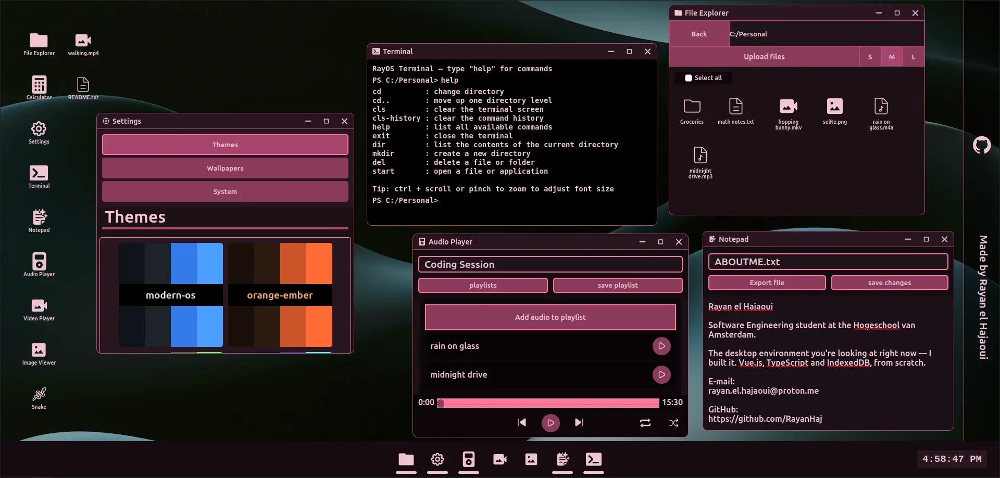

# **RayOS**

A desktop environment that runs entirely in the browser — I built it from scratch as my personal project and portfolio.

👉 **Try it live at [rayanelhajaoui.dev](https://rayanelhajaoui.dev)**



## What is RayOS?

RayOS turns a browser tab into a small operating system: draggable and resizable windows, a persistent filesystem, a file explorer, and apps running side by side — all client-side, no backend.

Files you create or upload are stored in **IndexedDB**, so your desktop survives reloads. On mobile, windows open fullscreen with the same core functionality.

## Features

- Draggable, resizable, focus-aware window management
- File explorer and Terminal with an attached filesystem backed by IndexedDB (persistent across sessions)
- File upload, images, video, audio and text files
- Responsive layout — full desktop experience on large screens, fullscreen windows on mobile
- Runs entirely client-side; no data ever leaves your browser

## Tech Stack

- [Vue 3](https://vuejs.org/) + [TypeScript](https://www.typescriptlang.org/)
- [Vite](https://vite.dev/)
- IndexedDB

## Project Setup

```sh
npm install
```

### Compile and Hot-Reload for Development

```sh
npm run dev
```

### Type-Check, Compile and Minify for Production

```sh
npm run build
```

### Lint with [ESLint](https://eslint.org/)

```sh
npm run lint
```

## Author

**Rayan el Hajaoui** — Software Engineering student at the Hogeschool van Amsterdam.

- E-mail: rayan.el.hajaoui@proton.me
- Portfolio: you're looking at it — [rayanelhajaoui.dev](https://rayanelhajaoui.dev)
